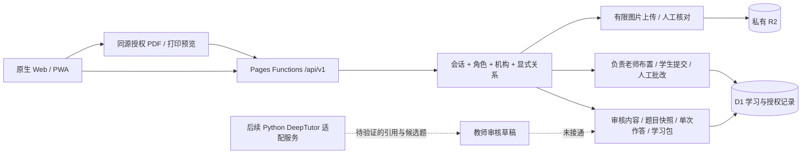

# 三项目整合架构与分阶段计划

**第七阶段更新（2026-11-14）**：老师专用方案/课后反馈工作区接入现有packs、homeworks、homework-summaries，API1.5.1仍46路径和4个迁移。新旧页面共用审核/批改组件；临时输入不持久化，提交冲突需比较最新版本；关系撤销与方案写入使用同一SQL授权条件。作业反馈依附真实提交，不引入课次、排课或推定进步。25类PDF/打印及原JSON/CSV保留。最新Antigravity LiveService、候选drop-in、隔离54题草稿另行评估，不整包覆盖或自动导入题目；详见STAGE7-TEACHER-WORKSPACE。

**第六阶段更新（2026-11-14）**：Antigravity通关包交互使用原生安全DOM接入真实数据。新增current-cycle/pack activity两条授权只读摘要（API1.5.0共46路径），写入/评分与四个迁移不变。暂态阅读不存为进步，25类导出保留。旧math范围截断与0–3/难度边界经合成实验记录，未迁入假成绩。详见STAGE6-ANTIGRAVITY-PACK。

**第五阶段更新（2026-11-14）**：已审核知识点专项筛查完成，API1.4.0/44路径、25类导出。范围来自已批准内容，随题目快照保存scopeMode/knowledgeTitle/版本；列表与成长只读历史快照，不倒填旧数据。沿用4个迁移，无新表。实际覆盖仍4点/12题且普通库待真人审核；DeepTutor完整RAG/生成未接入。详见STAGE5-SCOPED-ASSESSMENTS。

**第四阶段更新（2026-11-14）**：API1.3共44路径，25类保存内容导出。独立作业增加homeworks/items/answers/marks，以创建老师+显式绑定限定职责；状态draft→published→submitted→graded，题目来自已审核练习快照，学生本人提交、老师人工批改。复用独立实现的分值计算，按homeworkEvidence单独进入成长，绝不自动充当复测。详见STAGE4-HOMEWORK。thewyj的版本、幂等和事务边界继续作为设计参考，没有直接引入其会员或全站学习权限；授权背景与第三方许可记录保持不变。

**第三阶段更新**：Node本机Tesseract OCR已实际接入；ocr_runs保存未审核原文/教师修订，教师确认后才可引用到空阅卷草稿，评分继续由老师完成。API1.2共35路径，20类导出。Cloudflare默认OCR不可用；完整DeepTutor RAG/LLM仍未连接，只有有限上游模块及独立检索基线实验。详见STAGE3-OCR-RAG与RAG-LOCAL-EVALUATION，早期阶段描述作为沿革保留。

**第二阶段历史更新**：原型设计接真实API；结构化人工阅卷/部分分/能力观察/独立报告实现，详见STAGE2-HANDOFF。当时为API1.1，71点目录、历史导入、真实OCR、试卷自动匹配学习包尚未完成；后续OCR与作业进展以上方更新为准。

更新时间：2026-11-13。现场原 `math` HEAD `e56614db680fa83ac68210bec69f8d164e7c8fd0`；初次工作区干净，开发过程中出现Antigravity未跟踪`platform-ui/`，已保留。新平台在同级独立目录/独立Git分支`codex/mvp`，无remote、无提交/推送/部署。旧站点与生产数据未操作。

## 当前架构

Node24的SQLite/文件本地适配器运行相同业务层；Cloudflare本地workerd另验证D1/R2与密码KDF运行支持。二者互不混用数据。前端静态目录只有public/，不把项目根目录部署成静态站。

## 实际参考 thewyj.uk 的采用决定

固定SHA `4fc025a044e5e39d742166df9510d488413f7043`，已重点核查50文件、50文件blob一致，完整目录1589项。详细文件/函数及来源链接见 `THEWYJ-AUDIT.md`。

| 上游依据 | 新平台已经采用 | 暂不照搬 / 后续复用 |
|---|---|---|
| functions/api、cloudflare-foundation、D1迁移 | 同源版本化API、参数绑定、批处理、安全头、限流、明确失败 | 独立命名与资源配置，不复制正式数据库ID |
| task12会话与账号状态并发检查 | 随机令牌只存摘要；登录时再次匹配有效账号/密码版本；改密停用撤销会话 | Web localStorage令牌改为HttpOnly Cookie+CSRF；自定义KDF改为标准scrypt |
| task18管理员边界与服务端审计 | 管理员建号/关系/停用/脱敏审计；前端没有真实角色切换 | 重新设计机构+师生+亲子授权；不继承会员权益或全站管理员读学习数据 |
| task26题票、版本、单终结、事件幂等 | 服务端选择题目、snapshot_json、单次事务提交、重复提交409、匹配幂等、课程版本不符拒绝 | 完整事件重放/掌握度算法仍是候选；当前只显示真实计数，不假称掌握度已校准 |
| task14私有R2与清理补偿 | 随机对象键、私有访问、限流/限制大小/过期拒绝、上传失败补偿删除、人工删除 | 可靠delete_pending重试/孤儿扫描/生命周期仍需正式环境前实现 |
| sw版本与模块结构 | 公共应用壳白名单、版本、原生模块；不缓存学生API/图片/打印预览 | 当前只做基本PWA，不继承宽泛动态缓存或安装能力保证 |
| js/language/pdf.js、tools.js | 参考本地隐私、导出等待与分页设计，建立全站导出登记 | 上游Canvas→JPEG PDF实测有分页字体/截断风险；当前采用原生HTML/MathML/SVG→浏览器A4打印 |

本轮运行目录src/public为独立实现；已明确记录后续可筛选复用模块，不把用户授权错误解释成只能看架构。用户提供两位所有者“允许使用全部”的授权背景；商业、分发及第三方许可证据单独登记，不阻塞当前本地研发。

## 数据模型与来源

- organizations / users / relationships：最小别名、角色、机构、老师或家长对学生的授权。管理员不是学生数据的默认读取者。
- sessions / rate_limits：256bit不透明token摘要、8小时固定会话；D1原子限流键为HMAC，原始IP不落库。
- knowledge / questions / content_reviews：4示例点12原创样题、版本、出处、推导、机构级教师审核。自动答案核验≠人工审核。
- attempts / attempt_items / answers：诊断/练习/复测，服务器快照、实际选择、判分、提交者、source、时间；历史不接受客户端覆盖。
- packs：来源筛查、弱项、确定性规则版本、材料快照、老师调整、revision、draft→approved→in_progress→completed。
- uploads：私有图片TTL、人工文本、操作者和版本；OCR明确unavailable。确认文本不是题库入库，更不是成绩。
- audit_events：事件+随机对象ID+时间，不含密码/题目/作答/图像/用户输入。

成长档案是从实际submitted记录聚合，不使用演示历史、不把人工能力评分、照片部分分和在线选择题混成同一种证据。每阶段目前每点仅1题，不能外推完整能力或“提高百分比”。当前尚无设备/未成年人真实身份、学校、住址、手机号或行为追踪采集。

## DeepTutor 可落地对接

固定SHA `60fb3bdfddb30b7740c7ce3bd9b28d908f2af6db` v1.7.2，实际端点已从源码核实：`/api/knowledge-bases`、`/{kb_name}/upload`、`/api/mastery-paths/topics/draft`、`/topics`、WebSocket `/ws/questions/generate`。这些是**上游接口，不是新平台已经实现的API**。

已通过回环HTTP实际调用4个原始纯模块：命名、资料暂存/去重、判分、证据分数，18/18行为断言；包括明确观察到的不良判分反例。这不是RAG/完整服务或LLM集成验证，不产生准确率结论。完整运行需Python>=3.11,<3.15、所选模块依赖、持久化目录、鉴权和模型/embedding配置；不适合塞入Pages runtime。

适配服务后续固定来源/模型/版本，平台内部任务状态`queued/running/needs_review/failed/unavailable/needs_reindex`；只允许教师查看候选与引用；不允许模型写成绩或自动发布题目。具体schema草案与成本测量项见 `DEEPTUTOR-AUDIT.md`。Apache-2.0部分可按条款复用；PyMuPDF解析路径需单独解决AGPL/商业许可或验证替代方案。无模型调用成本发生，不编造预算。

## math 成果迁移

保留其范围选择、71数学知识点目录、识卷normalizeResult/输入限制、逐题人工复核、部分分与报告多口径、Chart.js图表经验，以及Antigravity预览界面。真实只读实验发现：旧筛查是0–3人工评分；全范围45槽只覆盖39/71点；章节可能误映射为首个知识点；预览把2/3映为72%且Mock来源可能丢失。全部要修复后再迁移。

第二阶段已新增独立paper_assessments/paper_items，支持逐小题、明确满分与实际部分分、0–3观察、章节/未映射、版本锁与写令牌事务、人工确认冻结。部分分不进入choice answers。迁移依据见MATH-MIGRATION，实际接口见API1.1。

## 分阶段交付与验收

| 阶段 | 具体产物 | 验收 |
|---|---|---|
| A 当前MVP | 账号/关系、12待真人审核样题、两科真实闭环、私有上传、14类PDF/打印、源码审计/最小探测 | 安全/事务/闭环测试、workerd本地验证、桌面/手机视口PDF成品；旧tracked diff为空 |
| B 前端与目录继承 | Antigravity服务适配、71点待教研目录、英语自有目录、独立demo/live | 无Mock回落，服务端分数一致，覆盖缺失明确提示，新增保存模块同步登记导出 |
| C 结构化人工阅卷 | paper_items、章节/知识点人工映射、partialScore、旧报告与PDF | 黄金样本聚合一致，未知满分不造分，来源/算法版本可追溯，重复确认幂等 |
| D DeepTutor/RAG+真实OCR小试 | 2份自有资料、每科3题候选、固定模型与成本记录、机构隔离 | 引用可定位、教师审题、权限/超时/限额失败；未经审核永不发布，无假准确率 |
| E 扩大试点 | 课程版本与事件回放、可靠清理、导入预览/幂等批次、分页导出、监护流程 | 真实小样本教学反馈、账号/数据删除保留策略、审计、安全与真机打印；另行决定部署 |

第一阶段不实现iOS/Android/鸿蒙App。业务API版本边界已预留；原生认证、刷新机制、推送和离线同步均须单独验证。没有自动部署或生产迁移任务。
